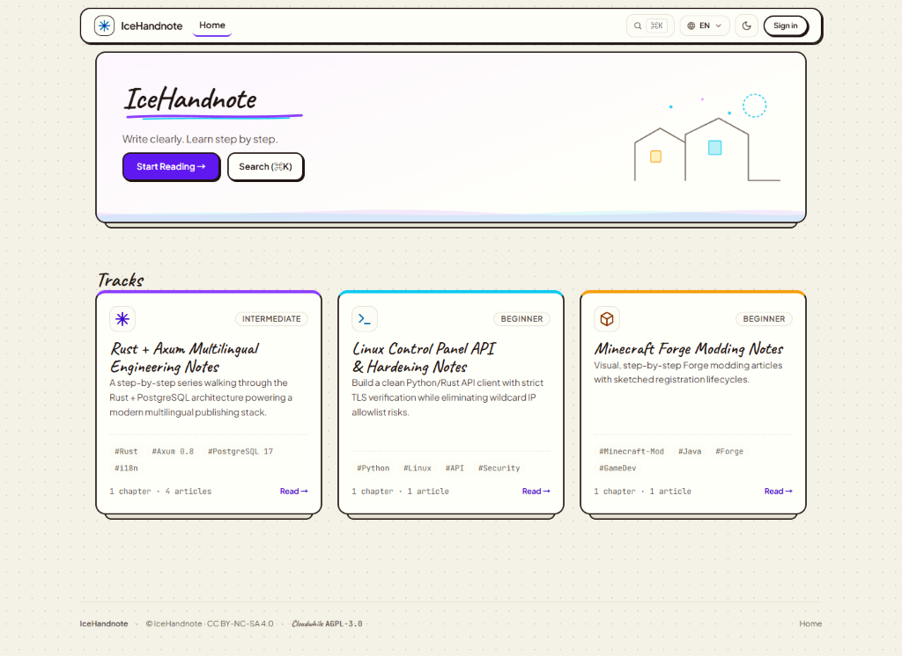

<div align="center">

# IceHandnote

**Open-source, white-label multilingual hand-drawn notebook & technical article platform.**

**English** | [简体中文](./locales/README.zh-CN.md)

[](https://github.com/Cloudwhile/icehandnote/actions/workflows/test.yml)
[](https://github.com/Cloudwhile/icehandnote/actions/workflows/docker.yml)
[](https://github.com/Cloudwhile/icehandnote/actions/workflows/binaries.yml)
[](https://github.com/Cloudwhile/icehandnote/releases)
[%3D'g'%5D%5B3%5D%2F*%5Blocal-name()%3D'text'%5D%5B2%5D&style=for-the-badge&logo=docker&logoColor=white&label=GHCR&color=2496ED&cacheSeconds=300)](https://github.com/Cloudwhile/icehandnote/pkgs/container/icehandnote)
[](./LICENSE)

<br />



</div>

---

## Highlights

- **Hand-Drawn Notebook & Drafting Paper Aesthetics**:
  - Dual-theme drafting code cards supporting 4 stationery styles (`washi` grid, `spiral` ruled, `index` paperclip card, `torn` draft slip) with WCAG AA syntax highlighting.
  - 3-axis decoupled in-article stickers (9 semantic types × 7 physical silhouettes × 6 dual-theme paper palettes + custom stamp badges) and interactive margin sticky notes on both paragraphs and code cards.
  - Per-article Creative Commons license selector (all CC 4.0 variants, CC0 1.0, All Rights Reserved) rendered as a hand-drawn postmark stamp card with localized CC deed links.
- **Dual-Scope Checkable Tasks**:
  - **Section Tasks (`## [ ] Heading`)**: Turn an entire section into a checkable milestone synced between heading and section footer.
  - **Paragraph Tasks (`- [ ] Title | Detail`)**: Inline checkable tasks woven between prose with persistent progress tracking.
- **Visual Block Editor + Lossless Markdown (`/:locale/studio`)**:
  - Bidirectional visual block editor and raw Markdown source editor with configurable draft auto-save, 4-locale (`zh-CN`, `en`, `zh-TW`, `ja`) translation matrix, and canonical revision drift detection.
- **Flexible White-Label & Auth**:
  - Live site identity, default theme, enabled locales, default CC license, built-in zero-DB local storage (with optional external PostgreSQL 17 + PGroonga support), and optional WordPress HMAC-SHA256 cross-site SSO bridge (`deploy/wordpress-sso-bridge.php`).

---

## Releases & Docker Images

### 1. Executable Releases (Windows & Linux)

Pre-built standalone bundles (containing `icehandnote-api`, `icehandnote-cli`, compiled `web/` SPA assets, and `content/`) are built automatically on every push via [GitHub Actions](https://github.com/Cloudwhile/icehandnote/actions/workflows/binaries.yml) and published on tagged [GitHub Releases](https://github.com/Cloudwhile/icehandnote/releases):

| Platform | Target | Archive | Checksum |
| :--- | :--- | :--- | :--- |
| **Windows (x64)** | `x86_64-pc-windows-msvc` | `icehandnote-windows-x86_64.zip` | `icehandnote-windows-x86_64.zip.sha256` |
| **Linux (x64)** | `x86_64-unknown-linux-gnu` | `icehandnote-linux-x86_64.tar.gz` | `icehandnote-linux-x86_64.tar.gz.sha256` |

### 2. GitHub Container Registry (GHCR) Images

| Image Tag | Description |
| :--- | :--- |
| `ghcr.io/cloudwhile/icehandnote:<tag>` | Published release tag version (e.g. `v0.1.0`) |
| `ghcr.io/cloudwhile/icehandnote:sha256-<digest>` | Unreleased latest build versioned by container `sha256` digest |
| `ghcr.io/cloudwhile/icehandnote:latest` | Latest build from the default `main` branch |

---

## Quick Start

### Option A: Docker / Docker Compose

```bash
# Build and start standalone IceHandnote (uses built-in local storage; set DATABASE_URL for external PostgreSQL)
docker compose up -d --build

# Or run the pre-built GHCR container directly
docker run -d --name icehandnote -p 3001:3001 ghcr.io/cloudwhile/icehandnote:latest
```

Open `http://127.0.0.1:3001`.

### Option B: Standalone Executable Bundle (Windows / Linux)

Extract the platform archive from Releases or Actions artifacts and run:

```bash
# Linux
./icehandnote-api

# Windows PowerShell
.\icehandnote-api.exe
```

`icehandnote-api` automatically serves `./web` and `./content` on `http://127.0.0.1:3001`.

### Option C: Local Development from Source

```bash
cp .env.example .env

# 1. Start Rust Axum API server (http://127.0.0.1:3001)
cargo run -p icehandnote-api

# 2. Start Vite dev server (http://127.0.0.1:5173)
pnpm --dir apps/web install
pnpm --dir apps/web dev
```

### Bootstrap an Admin Account (External PostgreSQL Mode)

```bash
cargo run -p icehandnote-cli -- create-admin \
  --username admin \
  --email admin@example.com \
  --display-name "Admin" \
  --role admin
```

> Set `ADMIN_PASSWORD` in the environment to specify a password; if omitted, the CLI generates a strong random password and prints it once.

---

## License

Licensed under the [GNU Affero General Public License v3.0](./LICENSE) · Copyright © [Cloudwhile](https://github.com/Cloudwhile).
