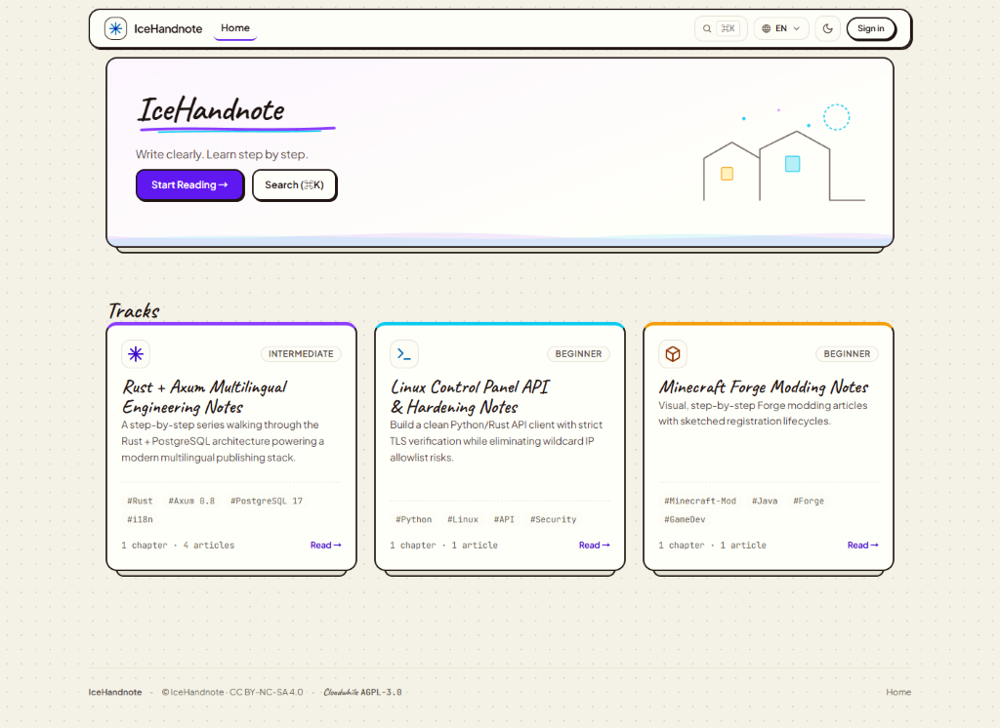

<div align="center">

# IceHandnote

**开源、可白标定制的多语言手写风笔记与技术文章平台。**

[English](../README.md) | **简体中文**

[](https://github.com/Cloudwhile/icehandnote/actions/workflows/test.yml)
[](https://github.com/Cloudwhile/icehandnote/actions/workflows/docker.yml)
[](https://github.com/Cloudwhile/icehandnote/actions/workflows/binaries.yml)
[](https://github.com/Cloudwhile/icehandnote/releases)
[](https://github.com/Cloudwhile/icehandnote/pkgs/container/icehandnote)
[](../LICENSE)

<br />



</div>

---

## 核心特性

- **手账与工程草稿纸视觉体系**：
  - 双主题工程手账代码卡，支持胶带方格（`washi`）、线圈横格（`spiral`）、回形针索引卡（`index`）、手撕草稿（`torn`）四种纸张形态，全部语法高亮 Token 满足 WCAG AA 对比度标准，同时支持 HTTP 与 HTTPS 一键复制。
  - 三轴解耦正文贴纸系统（9 种语义类型 × 7 种物理轮廓 × 6 套双主题配色 + 自定义角标），以及可按需吸附在正文段落与代码卡旁的读者/作者页边便签。
  - 支持作者按单篇文章自由选择 Creative Commons 许可协议（CC 4.0 全系列、CC0 1.0、保留所有权利），文章底部渲染手绘邮戳印章卡并自动匹配当前语种官方契约链接。
- **双模式文章内可勾选任务（节任务 & 段任务）**：
  - **节任务（`## [ ] 标题`）**：将整个小节设为可勾选里程碑，顶部标题复选框与节末完成按钮双向联动。
  - **段任务（`- [ ] 标题 | 说明`）**：在段落之间穿插轻量检查点，勾选进度自动同步。
- **可视化块编辑器 + Markdown 源码双模式（`/:locale/studio`）**：
  - 可视化块编辑与 Markdown 源码无损双向同步、可配置草稿自动保存、四语系（`en` / `zh-CN` / `zh-TW` / `ja`）翻译目录矩阵、主版本漂移检测与上游版本更新检查。
- **零外部依赖本地持久化 + 可选 PostgreSQL / SSO 桥接**：
  - 默认内置本地文件持久化（`DATA_DIR/store.json`），支持启动环境变量一键初始化管理员账号密码，也可通过 `DATABASE_URL` 连接外部 PostgreSQL 17 + PGroonga，并附带可选 WordPress HMAC-SHA256 单点登录桥接插件（`deploy/wordpress-sso-bridge.php`）。

---

## 发行版（Release）与 Docker 镜像版本

### 1. Windows & Linux 独立可执行包

每次推送均由 [GitHub Actions](https://github.com/Cloudwhile/icehandnote/actions/workflows/binaries.yml) 自动编译打包（内置 `icehandnote-api`、`icehandnote-cli`、`web/` 前端静态产物与 `content/` 示例内容），推送 `v*` 版本标签时自动发布至 [GitHub Releases](https://github.com/Cloudwhile/icehandnote/releases)：

| 平台 | 编译目标 | 发行压缩包 | SHA-256 校验文件 |
| :--- | :--- | :--- | :--- |
| **Windows (x64)** | `x86_64-pc-windows-msvc` | `icehandnote-windows-x86_64.zip` | `icehandnote-windows-x86_64.zip.sha256` |
| **Linux (x64)** | `x86_64-unknown-linux-gnu` | `icehandnote-linux-x86_64.tar.gz` | `icehandnote-linux-x86_64.tar.gz.sha256` |

### 2. GitHub Container Registry (GHCR) 容器镜像

| 镜像标签 | 说明 |
| :--- | :--- |
| `ghcr.io/cloudwhile/icehandnote:<tag>` | 已发布版本标签镜像（按发布 `tag` 作为版本号，如 `v0.1.0-rc.4`） |
| `ghcr.io/cloudwhile/icehandnote:latest` | 最新 `v*` 发布标签镜像（仅在推送 `v*` tag 时更新，绝不打在 `sha256-*` 分支快照上） |
| `ghcr.io/cloudwhile/icehandnote:sha256-<digest>` | 未打标签的 `main` 分支最新快照镜像（按镜像 `sha256` 摘要作为版本号） |

---

## 快速部署

### 方式一：Docker 一键部署（含数据持久化与初始管理员账号密码）

```bash
docker run -d \
  --name icehandnote \
  --restart unless-stopped \
  -p 3001:3001 \
  -v $(pwd)/data:/app/data \
  -v $(pwd)/content:/app/content \
  -e ADMIN_USERNAME=admin \
  -e ADMIN_PASSWORD=ChangeMe_StrongPassword \
  -e DEFAULT_LOCALE=zh-CN \
  ghcr.io/cloudwhile/icehandnote:latest
```

或使用 **Docker Compose**（在 `.env` 中配置 `ADMIN_PASSWORD` 后启动）：

```bash
cp .env.example .env
docker compose up -d
```

启动后访问 `http://127.0.0.1:3001`（管理后台入口：`http://127.0.0.1:3001/zh-CN/studio`）。

### 部署与持久化参数说明

| 环境变量 / 挂载卷 | Docker 默认值 | 说明 |
| :--- | :--- | :--- |
| `-v ./data:/app/data`（`DATA_DIR`） | `/app/data` | 持久化账号、登录会话、站点设置、页边笔记、点赞与任务进度（`store.json`）。 |
| `-v ./content:/app/content`（`CONTENT_DIR`） | `/app/content` | 持久化 Markdown 文章与 `track.toml` 目录配置（首次挂载为空目录时自动写入示例笔记）。 |
| `ADMIN_USERNAME` | `admin` | 启动时初始化/更新的管理员用户名。 |
| `ADMIN_PASSWORD` | *（自动生成）* | 管理员初始密码；若首次启动未指定，会自动生成随机密码并输出在 `docker logs icehandnote` 中。 |
| `ADMIN_EMAIL` | `admin@localhost` | 管理员邮箱地址。 |
| `DEFAULT_LOCALE` | `en` | 默认站点语言（支持 `zh-CN`、`en`、`zh-TW`、`ja`）。 |
| `SITE_NAME` | `IceHandnote` | 初始站点名称（也可在后台「站点设置」实时修改）。 |
| `DATABASE_URL` | *（不设）* | 可选外部 PostgreSQL 17（PGroonga）连接串。 |

### 方式二：Windows / Linux 独立可执行包

下载对应平台压缩包解压后运行：

```bash
# Linux
ADMIN_USERNAME=admin ADMIN_PASSWORD=ChangeMe_StrongPassword DATA_DIR=./data ./icehandnote-api

# Windows PowerShell
$env:ADMIN_USERNAME="admin"; $env:ADMIN_PASSWORD="ChangeMe_StrongPassword"; $env:DATA_DIR="./data"; .\icehandnote-api.exe
```

`icehandnote-api` 会自动托管同目录下的 `web/`、`content/` 与 `data/store.json`，默认监听 `http://127.0.0.1:3001`。

### 方式三：本地源码开发

```bash
cp .env.example .env

# 1. 启动 Rust Axum API 后端（http://127.0.0.1:3001）
cargo run -p icehandnote-api

# 2. 启动 Vite 前端开发服务（http://127.0.0.1:5173）
pnpm --dir apps/web install
pnpm --dir apps/web dev
```

### 通过 CLI 创建或重置管理员密码

```bash
# 同时支持内置本地存储（DATA_DIR）与外部 PostgreSQL（DATABASE_URL）
icehandnote-cli create-admin \
  --username admin \
  --email admin@example.com \
  --display-name "Admin" \
  --role admin \
  --password "ChangeMe_StrongPassword"
```

---

## 开源协议

本项目基于 [GNU Affero General Public License v3.0](../LICENSE) 协议开源 · Copyright © [Cloudwhile](https://github.com/Cloudwhile)。
